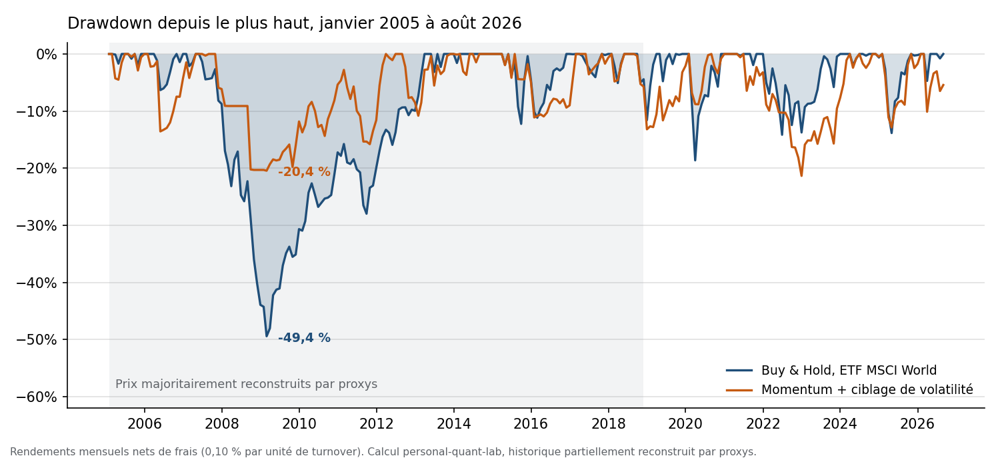
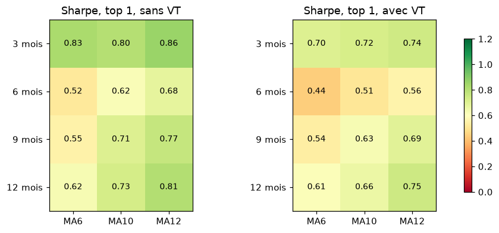

# personal-quant-lab

**Laboratoire de backtest pour un investisseur PEA de long terme. 9 stratégies, 81 variantes, 18 ans de données et une conclusion honnête.**

Python · pandas · NumPy · scikit-learn · matplotlib · 479 tests · intégration continue sous Ubuntu et Windows (Python 3.12 et 3.14, ruff, mypy, pytest)

## Principaux résultats

- **Aucune stratégie ne bat le Buy & Hold une fois les tests multiples pris en compte.** 81 variantes ont été évaluées sur 2008-2026 avec le Probabilistic Sharpe Ratio et le Deflated Sharpe Ratio.
- **Le momentum optimisé en walk-forward surapprend.** Avec des paramètres re-sélectionnés hors échantillon, il fait moins bien que le Buy & Hold sur 2019-2026 (Sharpe 0,57 contre 1,07, écart de -0,50 avec un intervalle de confiance bootstrap à 90 % de [-0,90 ; -0,12]).
- **Courir après la meilleure stratégie récente n'aide pas.** Choisir chaque année la stratégie qui a le mieux marché donne un Sharpe hors échantillon de 0,89, contre 0,99 pour le Buy & Hold.
- **Les stratégies défensives jouent leur rôle en crise.** En 2008-09, le momentum avec ciblage de volatilité limite le drawdown à -20,4 %, contre -49,4 % pour le Buy & Hold.
- **Le machine learning a été testé puis écarté.** Un overlay de régimes de marché en walk-forward obtient un ROC-AUC inférieur à 0,5.



## Robustesse en un coup d'œil

De février 2008 à août 2026, 223 mois, frais de 0,10 % par unité de turnover.

| Stratégie | CAGR | Sharpe | Drawdown max | Sharpe dégonflé | Surperformance vs B&H |
|---|---:|---:|---:|---:|---|
| Buy & Hold, ETF MSCI World | 9,9 % | 0,78 | -39,1 % | 98 % | référence |
| Momentum défensif | 10,0 % | 0,73 | -24,3 % | 97 % | non démontrée |
| Momentum + ciblage de volatilité | 7,2 % | 0,66 | -20,9 % | 94 % | non démontrée |
| 60/40 actions / obligations | 6,6 % | 0,79 | -25,2 % | 98 % | possible |
| Dual momentum | 13,0 % | 0,86 | -20,1 % | 99 % | possible |
| Top 3 équipondéré + tendance | 10,7 % | 0,93 | -16,6 % | 100 % | non démontrée |

> **Limite des données.** Avant la cotation des ETF PEA, les prix sont reconstruits à partir de proxys de même exposition. En moyenne, 50 % de la fenêtre 2008-2026 est synthétique, et 100 % de 2008-2012. Les résultats postérieurs à 2018 reposent surtout sur des prix réels d'ETF. Détails dans `config/long_history.yaml`.



> Usage éducatif et paper trading uniquement. Aucun ordre n'est jamais exécuté, la décision reste humaine, et rien ici n'est un conseil en investissement.

**Mode d'emploi complet dans [docs/USAGE.md](docs/USAGE.md).**

## Démarrage rapide

```powershell
powershell -ExecutionPolicy Bypass -File scripts\setup.ps1         # installation + tests
.venv\Scripts\python.exe main.py profile --questionnaire          # mon profil (une fois)
.venv\Scripts\python.exe main.py plans                             # plans d'investissement simulés
.venv\Scripts\python.exe main.py status                            # où en suis-je ?
.venv\Scripts\python.exe main.py run-month --refresh-data          # routine mensuelle
.venv\Scripts\python.exe main.py paper-decision --month 2026-10 --status APPROVED_PAPER --strategy allocation_fixe --confidence 4
.venv\Scripts\python.exe main.py plan-contribution --record         # proposition d'achats du versement
.venv\Scripts\python.exe main.py policy                              # politique suivie et contrôles
.venv\Scripts\python.exe main.py portfolio                           # portefeuille réel (transactions.csv)
powershell -ExecutionPolicy Bypass -File scripts\dashboard.ps1     # tableau de bord
```

## État des projets

| Projet | État | Où |
| ------ | ---- | -- |
| 0 — Socle technique (données, métriques) | Terminé | `src/data_loader.py`, `src/metrics.py` |
| 1 — Benchmark Buy & Hold | Terminé | `notebooks/02_benchmark_buy_hold.ipynb` |
| 1B — Versements mensuels (DCA) | Terminé | `main.py dca`, `reports/dca_report.md` |
| 2 — Momentum défensif PEA | Validé techniquement | `notebooks/03_momentum_pea.ipynb`, `reports/momentum_pea_report.md` |
| 3 — Volatility Targeting | Validé techniquement | `notebooks/04_volatility_targeting.ipynb`, `reports/volatility_targeting_report.md` |
| 4 — Rapport mensuel | Validé techniquement | `main.py run-month`, `reports/monthly/` |
| 4B — Paper trading | **Phase active** (4 mois renseignés, règle des 3 mois atteinte) | `reports/paper_trading/`, `main.py paper-performance` |
| Plan de versement | Terminé (proposition, aucun ordre) | `main.py plan-contribution`, `config/positions.yaml` |
| Frais réels et fiscalité | Terminé (simplifié) | `main.py costs`, section `costs` / `fiscalite` |
| Robustesse des stratégies | Terminé — preuves, choix humain | `main.py research [--long]`, `notebooks/11_strategy_robustness.ipynb` |
| Politique d'investissement + registre de stratégies | Terminé (défaut momentum_vt, choix humain) | `config/policy.yaml`, `src/strategies.py`, `main.py policy` |
| Expositions et véhicules | Terminé | `assets.yaml > exposure`, `main.py vehicles` |
| Historique long et stress tests | Terminé (données partiellement synthétiques) | `main.py refresh-data --long`, `main.py stress`, notebook 12 |
| Portefeuille réel | Terminé (journal personnel) | `config/transactions.csv`, `main.py portfolio` |
| 4C — Univers ETF PEA + rôles d'actifs | Validé techniquement | `config/assets.yaml`, notebooks `07`, `07b` |
| 5 — ML régimes de marché | Terminé — **overlay non retenu** | `main.py regime`, `notebooks/09_market_regime_ml.ipynb`, `reports/market_regime_report.md` |
| 6 — Crypto BTC/ETH | Recherche terminée (non branchée) | `notebooks/10_crypto_risk_on_off.ipynb`, `reports/crypto_report.md` |
| 7 — Pilotage patrimonial | Terminé | `main.py patrimoine`, `reports/patrimoine_report.md` |
| 8 — Automatisation locale | Script prêt (planification manuelle) | `scripts/run_monthly.ps1` |
| 9 — Notifications | Prêt, **désactivé par défaut** | `config/notify.example.yaml`, `run-month --notify` |
| Profil investisseur | Terminé (personnel, questionnaire) | `config/profil.yaml`, `main.py profile` |
| Plans d'investissement (PEA, assurance-vie, CTO, crypto) | Terminé — scénarios, pas des conseils | `config/plans.yaml`, `main.py plans` |
| Fiches et robustesse des stratégies | Terminé | `main.py strategies`, `main.py robustness` |
| Tableau de bord local | Terminé (refonte v5 : accueil, profil, plans, stratégies ; thème clair/sombre) | `app/dashboard.py` |

« Validé techniquement » = code testé, notebook exécuté, rapport rédigé. Ce n'est **pas**
une recommandation d'investissement.

## Constats de recherche (données au 2026-09-23)

- **Plans d'investissement (v6)** : avec des hypothèses de rendement explicites, l'écart entre
  plans devient faible (scénario central : ~29 à 32 k€ pour 150 €/mois pendant 15 ans), alors que
  l'hypothèse elle-même fait varier le résultat de ~26 k€ (défavorable) à ~44 k€ (historique) :
  le choix du plan pèse moins que l'incertitude sur les rendements futurs.
- **Données (v6)** : trois ETF de l'univers étaient mal décrits (ESE.PA, GWT.PA, OBLI.PA devenu
  monétaire) ; fiscalité 2026 intégrée (prélèvements sociaux 18,6 %, assurance-vie 17,2 %).

- **Robustesse (2008-2026, 81 variantes, v5)** : les 9 stratégies sont « fiables » (aucune ne
  s'effondre selon la période, les réglages ou les frais), mais **aucune surperformance face au
  Buy & Hold n'est démontrée** après correction des tests multiples ; le 60/40 est la seule
  protection « forte ». Changer chaque année pour la meilleure stratégie récente fait moins
  bien que le Buy & Hold (Sharpe 0,89 contre 0,99). Le réglage actuel de Momentum + VT
  (volatilité sur 3 mois) est 11e sur 12 dans sa grille ; une fenêtre de 12 mois est plus
  robuste (piste à tester en paper trading, rien n'est changé). Voir
  `reports/research/robustness_report.md` et `strategy_cards.md`.

- **Historique long 2008-2026** (proxys avant la cotation des ETF PEA, signalés) : toujours
  aucune stratégie significativement meilleure que le Buy & Hold (top 3 + tendance : Sharpe
  0,93 contre 0,77, IC 90 % contenant zéro). **Stress** : en 2008-09, Momentum + VT limite le
  drawdown à −20 % contre −51 % pour le Buy & Hold ; en 2011 et 2015-16, le 60/40 protège le
  mieux. Sur 30 ans de versements simulés, Momentum + VT a une médiane plus basse mais une
  probabilité de dépasser −25 % de drawdown de 46 % contre 88 % pour le Buy & Hold.
  Voir `reports/research/stress_report.md`.
- **Libellés corrigés** (2026-09-23) : PUST.PA se comporte comme le **Nasdaq-100** (et non le
  S&P 500) et PAASI.PA comme l'**Asie émergente** (et non le Pacifique hors Japon) ; le vrai
  S&P 500 PEA (PSP5.PA) est documenté inactif. À confirmer sur les fiches émetteurs.
- **Véhicules** : WPEA.PA suit CW8.PA à 0,17 % de tracking error mensuelle ; une part de CW8.PA
  (~700 €) dépasse le versement de 400 € : le plan bascule sur WPEA.PA.

- **Robustesse (2019-01 → 2026-08, 80 variantes)** : aucune stratégie ne bat le Buy & Hold
  CW8.PA en Sharpe de façon statistiquement robuste (IC 90 % par bootstrap). Le Momentum aux
  paramètres choisis en walk-forward fait *significativement moins bien* (Sharpe 0,57 contre
  1,07) et le classement de la grille est instable : signe de surapprentissage. Inverse
  volatilité (Sharpe 1,17) et 80/20 CW8/OBLI (1,02) sont les alternatives les plus proches,
  sans écart significatif. Voir `reports/research/strategy_research_report.md`.
- **Paper trading** (juillet-août 2026) : mes décisions +1,07 %, proposition du système
  +1,01 %, Buy & Hold +1,36 % — trop court pour conclure.

- Sur 2015-2026 (univers enrichi, frais 0,10 %), le **Momentum** (CAGR 11,6 %, Sharpe 0,80,
  max DD −24,3 %) ne bat pas le **Buy & Hold CW8.PA** (CAGR 11,4 %, Sharpe 0,89, max DD
  −18,6 %) en rendement ajusté du risque. **Momentum + VT** réduit la volatilité mais
  aussi fortement le rendement (CAGR 7,5 %).
- Avec 400 €/mois depuis 2015 (`main.py dca`) : Buy & Hold 121 k€, Momentum 124 k€,
  Momentum + VT 90 k€ pour 55,6 k€ versés.
- L'overlay **ML** de régimes n'améliore ni le Sharpe ni le drawdown en walk-forward
  (ROC-AUC < 0,5) : il reste un simple indicateur de contexte.
- **Crypto (recherche)** : le filtre risk-on/off 70/30 BTC/ETH ramène le max drawdown de la
  poche de −76 % à −46 % (Sharpe 0,70 → 0,87) sur 2017-2026 ; une poche de 5-10 % améliore le
  Sharpe du portefeuille global dans cet échantillon court. Hors PEA, non branché, pas d'ordre.

## Commandes

| Commande | Rôle |
| -------- | ---- |
| `status` | État du lab et prochaines actions |
| `run-month [--refresh-data] [--html] [--notify]` | Rapport + entrée du journal + comparaison + performance paper |
| `monthly-report [--html]` | Rapport mensuel seul (Markdown + JSON + graphiques, HTML autonome) |
| `refresh-data [--full]` | Mise à jour incrémentale des prix, contrôles qualité, archive brute |
| `paper-init` / `paper-list` / `paper-decision` | Journal de paper trading (confiance, pour / contre) |
| `paper-performance` | Performance fictive de mes décisions vs système vs benchmark |
| `plan-contribution` | Proposition d'achats du versement (aucun ordre) |
| `costs` | Sensibilité aux frais |
| `research [--long]` | Robustesse des stratégies (données réelles ou historique long) |
| `policy` | Politique d'investissement et contrôles |
| `portfolio` | Portefeuille réel (TWR, TRI, frais, PEA) |
| `vehicles` | Expositions, véhicules, écart de suivi |
| `stress` | Stress tests de crise et distribution des versements |
| `profile [--questionnaire]` | Profil investisseur (personnel) et repères indicatifs |
| `plans [--prudent]` | Plans d'investissement simulés pour le profil |
| `strategies` | Fiches détaillées des stratégies |
| `robustness` | Verdicts de fiabilité, surperformance et protection |
| `universe` | Identité des ETF (ISIN, frais, PEA) et points d'attention |
| `frais` | Audit des frais (ordres, ETF, fiscalité) |
| `rendement-max` | Gains et pertes possibles des options plus risquées (pédagogique) |
| `compare-reports` | Comparaison de deux rapports mensuels |
| `patrimoine` | Rapport patrimonial (valeurs dans `config/holdings.yaml`, non versionné) |
| `dca` | Simulation des versements mensuels |
| `regime` | Étude ML des régimes de marché |
| `validate` | Validation de la configuration |

Codes de sortie : `0` succès, `1` erreur technique ou d'usage, `2` rapport généré mais
statut `CRITICAL`.

## Structure

```
personal-quant-lab/
├── app/                     # tableau de bord Streamlit (ui.py, planning.py, app_pages/)
├── .streamlit/config.toml   # thème clair et sombre du tableau de bord
├── config/
│   ├── assets.yaml          # univers ETF, rôles (candidate / defensive / cash_proxy)
│   ├── strategy_params.yaml # paramètres Momentum, VT, frais, univers
│   ├── patrimoine.yaml      # profil, fiscalité, PEA, enveloppes, allocation cible
│   ├── policy.yaml          # politique d'investissement (stratégie suivie, garde-fous)
│   ├── long_history.yaml    # chaînes de proxys de l'historique long
│   └── *.example.*          # modèles positions / holdings / notify / transactions (copies personnelles non versionnées)
├── data/                    # prix locaux (processed/) et archives brutes (raw/), non versionnés
├── docs/                    # USAGE.md, snapshot_schema.md, MASTER_PROMPT.md
├── notebooks/               # recherche (02 → 12)
├── reports/
│   ├── monthly/             # rapports mensuels .md/.json + figures/
│   ├── paper_trading/       # journal de décisions, comparaisons, performance.md
│   └── research/            # robustesse (courte et longue), stress tests (Markdown + JSON)
├── scripts/                 # setup.ps1, run_monthly.ps1, dashboard.ps1, check.ps1
├── src/
│   ├── cli/                 # commandes de main.py (rapport, paper, patrimoine, recherche)
│   ├── data_loader.py       # téléchargement / validation / stockage des prix
│   ├── universe.py          # univers ETF et rôles d'actifs
│   ├── features.py          # momentum, moyenne mobile, tendance, volatilité
│   ├── signals.py           # éligibilité, classement, poids, décalage d'exécution
│   ├── portfolio.py         # volatility targeting
│   ├── backtest.py          # buy & hold, backtest mensuel avec frais
│   ├── metrics.py           # CAGR, volatilité, Sharpe, drawdown
│   ├── monthly_pipeline.py  # orchestration mensuelle, alertes, modèle de données
│   ├── reporting.py         # rapport Markdown + snapshot JSON
│   ├── report_figures.py    # graphiques PNG du rapport
│   ├── paper_trading.py     # journal de paper trading
│   ├── routine.py           # état du lab et routine mensuelle
│   ├── dca.py               # versements mensuels (Projet 1B)
│   ├── market_regime.py     # ML régimes de marché (Projet 5)
│   ├── crypto_signals.py    # crypto risk-on / risk-off (Projet 6, recherche)
│   ├── patrimoine.py        # pilotage patrimonial (Projet 7)
│   ├── paper_ledger.py      # portefeuille fictif du journal
│   ├── positions.py         # positions réelles (parts) et valorisation
│   ├── contribution_plan.py # plan de versement (proposition)
│   ├── costs.py, taxes.py   # frais d'ordre réels, fiscalité simplifiée
│   ├── cost_sensitivity.py  # sensibilité aux frais
│   ├── research.py          # robustesse des stratégies
│   ├── engine.py            # moteur de backtest unique des études
│   ├── results.py           # format commun des résultats JSON (bloc meta)
│   ├── pipeline_config.py   # configuration du rapport mensuel (pipeline_models, pipeline_alerts)
│   ├── strategies.py        # registre unique des stratégies
│   ├── strategy_cards.py    # fiches pédagogiques des stratégies
│   ├── robustness.py        # PSR / DSR, fenêtres glissantes, plateaux, walk-forward
│   ├── investor_profile.py  # questionnaire et repères du profil
│   ├── plans.py             # plans d'investissement : projection, vrai passé, adéquation
│   ├── plans_report.py      # rapport et graphiques des plans
│   ├── policy.py            # politique d'investissement et contrôles
│   ├── vehicles.py          # expositions, véhicules, proxys
│   ├── long_history.py      # historique long par proxys (synthétique)
│   ├── stress.py            # fenêtres de crise, distribution des versements
│   ├── ledger.py            # journal de transactions, TWR / TRI, règles du PEA
│   ├── month_summary.py     # résumé du mois en HTML
│   ├── data_quality.py      # refresh incrémental, contrôles qualité, archives
│   ├── notify.py            # notifications ntfy (désactivées par défaut)
│   ├── html_report.py       # export HTML autonome
│   └── plotting.py
├── tests/                   # pytest, hors-ligne et déterministes
├── main.py                  # point d'entrée de la CLI (src/cli/)
├── .github/workflows/       # intégration continue (à activer en créant un dépôt GitHub privé)
└── pyproject.toml           # configuration pytest / ruff / mypy
```

## Conventions financières

- **Anti-look-ahead** : signal calculé en fin de mois M, exécuté en M+1 ; la volatilité
  connue en M-1 dimensionne M ; le rapport utilise le dernier mois civil **complet** et
  tronque les données à la date d'arrêté (`--report-date`).
- **Poids** : chaque allocation somme exactement à 100 %, part non investie en `CASH`
  explicite (rémunérée au rendement de CSH2.PA quand disponible).
- **Frais** : rotation calculée après dérive des poids ; commissions sur les montants
  achetés **et** vendus hors cash. Le simulateur PEA utilise les parts entières et le barème courtier.
- **Données** : Yahoo Finance via yfinance, prix ajustés (approximation total-return, non
  officielle). Pas de forward-fill ; fiscalité et slippage non modélisés.
- **Snapshot JSON** = contrat de données versionné : [docs/snapshot_schema.md](docs/snapshot_schema.md).

## Tests

```powershell
.venv\Scripts\python.exe -m pytest -m "not slow"   # mode rapide
.venv\Scripts\python.exe -m pytest -n auto         # ~500 tests en parallèle, sans Internet
powershell -ExecutionPolicy Bypass -File scripts\check.ps1   # ruff + tests + couverture
```

## Prochaine étape

La politique « Monde + émergents » (85/15) est conservée comme référence. La recherche
tactique vise désormais un objectif de baisse de 30 %, sans garantie. Avant toute alerte
personnalisée, importer et rapprocher les opérations d'un relevé Bourso, puis confirmer
les produits et le canal de notification. La documentation historique détaillée des projets
est dans [guide_personal_quant_lab.md](guide_personal_quant_lab.md) et
[docs/data_loader_explained.md](docs/data_loader_explained.md).
