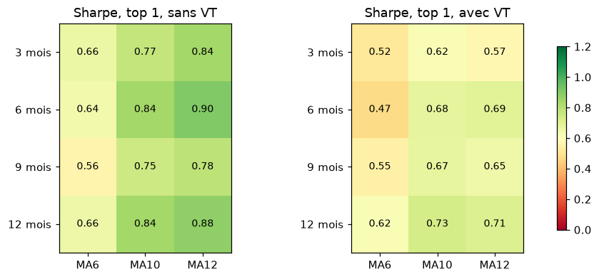

# Robustesse des stratégies — quelle stratégie suivre ?

Date de génération : 2026-09-25

Étude de recherche : elle fournit des preuves, **elle ne change pas la stratégie suivie**. Aucun ordre n'est exécuté.

## Méthode

- Fenêtre commune : 2019-01-31 → 2026-08-31 (92 mois), mêmes mois pour toutes les stratégies ; signal de fin de mois appliqué le mois suivant ; cash explicite.
- Frais : 0.10% par unité de turnover (colonne CAGR), 0.30% en sensibilité, barème réel équivalent 0.10%.
- Grille Momentum : 72 configurations ; walk-forward par blocs de 12 mois, paramètres choisis sur tout le passé disponible (≥ 36 mois).
- Intervalle de confiance à 90 % de l'écart de Sharpe avec le Buy & Hold : bootstrap par blocs circulaires de 6 mois (2000 tirages, rendements appariés).

## Tableau de preuves

| Stratégie | CAGR | Volatilité | Sharpe | Écart de Sharpe vs B&H [IC 90 %] | P(écart > 0) | Max drawdown | Turnover / an | CAGR à 0.30% | CAGR barème réel |
| --- | ---: | ---: | ---: | ---: | ---: | ---: | ---: | ---: | ---: |
| Buy & Hold CW8.PA | 14.7% | 13.8% | 1.07 | — | — | -18.6% | 0% | 14.7% | 14.7% |
| Momentum + Volatility Targeting | 8.8% | 12.7% | 0.73 | -0.34 [-0.85 ; +0.09] | 10% | -20.9% | 458% | 7.8% | 8.8% |
| Momentum 12-1 MA10 top 1 (défaut) | 13.8% | 17.1% | 0.84 | -0.23 [-0.67 ; +0.15] | 17% | -24.3% | 443% | 12.8% | 13.8% |
| Momentum, paramètres choisis en walk-forward | 6.8% | 12.9% | 0.57 | -0.50 [-0.90 ; -0.12] | 2% | -27.5% | 513% | 5.7% | n/a |
| Dual momentum (actions / obligataire / cash) | 17.5% | 18.1% | 0.98 | -0.08 [-0.60 ; +0.36] | 36% | -20.1% | 378% | 16.6% | 17.5% |
| Top 3 équipondéré + tendance | 12.9% | 13.7% | 0.96 | -0.11 [-0.52 ; +0.22] | 27% | -16.6% | 243% | 12.3% | 12.9% |
| Inverse volatilité (actions) | 16.0% | 13.5% | 1.17 | +0.10 [-0.15 ; +0.31] | 76% | -16.5% | 38% | 15.9% | 16.0% |
| 80/20 CW8.PA / OBLI.PA | 11.7% | 11.5% | 1.02 | -0.04 [-0.11 ; +0.04] | 18% | -15.6% | 13% | 11.7% | 11.7% |
| 60/40 CW8.PA / OBLI.PA | 8.7% | 9.3% | 0.94 | -0.13 [-0.29 ; +0.07] | 14% | -15.5% | 13% | 8.6% | 8.7% |

## Conclusion factuelle

- Aucune stratégie ne bat le Buy & Hold CW8.PA en Sharpe de façon statistiquement robuste sur cette période (tous les intervalles à 90 % contiennent zéro ou sont négatifs).
- Sharpe significativement inférieur au Buy & Hold : Momentum, paramètres choisis en walk-forward.
- Stabilité de la grille Momentum : corrélation de rang -0.18 entre les deux moitiés de la période (classement instable : les « meilleurs » paramètres d'hier ne le restent pas).
- 80 variantes testées : le meilleur résultat observé est probablement surestimé (tests multiples) ; ne retenir que des écarts robustes et explicables.
- Le choix de la stratégie à suivre reste une décision humaine (`paper-decision`).

## Paramètres choisis en walk-forward

| Bloc testé | Configuration choisie | Sharpe en entraînement |
| --- | --- | ---: |
| 2019-01-31 → 2019-12-31 | L3-MA6-top3-VT | 0.74 |
| 2020-01-31 → 2020-12-31 | L12-MA6-top3-noVT | 1.30 |
| 2021-01-31 → 2021-12-31 | L3-MA12-top1-noVT | 1.25 |
| 2022-01-31 → 2022-12-31 | L3-MA12-top1-noVT | 1.40 |
| 2023-01-31 → 2023-12-31 | L3-MA12-top3-noVT | 0.94 |
| 2024-01-31 → 2024-12-31 | L3-MA12-top3-noVT | 0.98 |
| 2025-01-31 → 2025-12-31 | L6-MA12-top3-noVT | 1.05 |
| 2026-01-31 → 2026-08-31 | L3-MA12-top3-noVT | 0.97 |

## Stabilité de la grille Momentum

Corrélation de rang des Sharpe entre les deux moitiés (coupure 2022-11-30) : **-0.18**.

| Configuration | Sharpe total | 1re moitié | 2e moitié |
| --- | ---: | ---: | ---: |
| L12-MA12-top3-noVT | 1.02 | 0.89 | 1.12 |
| L6-MA12-top3-noVT | 1.01 | 1.16 | 0.89 |
| L12-MA12-top2-noVT | 1.00 | 0.80 | 1.16 |
| L9-MA12-top3-noVT | 0.97 | 0.93 | 1.00 |
| L6-MA12-top2-noVT | 0.97 | 1.05 | 0.91 |
| L3-MA6-top2-noVT | 0.49 | 0.92 | 0.08 |
| L6-MA6-top1-VT | 0.47 | 0.62 | 0.33 |
| L3-MA6-top2-VT | 0.41 | 0.77 | 0.06 |

_5 meilleures et 3 moins bonnes configurations sur la fenêtre commune._

## Limites

- Historique court (≈ 7-8 ans de fenêtre commune) et univers restreint ; un seul grand krach (2020).
- Données Yahoo Finance ; fiscalité non incluse (neutre dans un PEA tant qu'aucun retrait n'a lieu).
- Les performances passées ne préjugent pas des performances futures.
