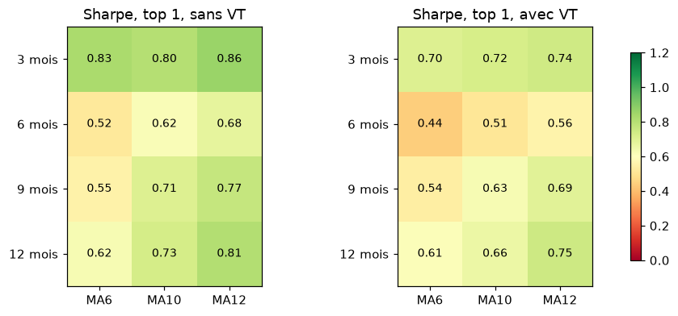

# Robustesse des stratégies — quelle stratégie suivre ?

Date de génération : 2026-09-25

Étude de recherche : elle fournit des preuves, **elle ne change pas la stratégie suivie**. Aucun ordre n'est exécuté.

> **Données** : historique long partiellement SYNTHÉTIQUE (proxys de même exposition avant la cotation des ETF PEA, voir config/long_history.yaml) ; cash non rémunéré.

## Méthode

- Fenêtre commune : 2008-02-29 → 2026-08-31 (223 mois), mêmes mois pour toutes les stratégies ; signal de fin de mois appliqué le mois suivant ; cash explicite.
- Frais : 0.10% par unité de turnover (colonne CAGR), 0.30% en sensibilité, barème réel équivalent 0.10%.
- Grille Momentum : 72 configurations ; walk-forward par blocs de 12 mois, paramètres choisis sur tout le passé disponible (≥ 36 mois).
- Intervalle de confiance à 90 % de l'écart de Sharpe avec le Buy & Hold : bootstrap par blocs circulaires de 6 mois (2000 tirages, rendements appariés).

## Tableau de preuves

| Stratégie | CAGR | Volatilité | Sharpe | Écart de Sharpe vs B&H [IC 90 %] | P(écart > 0) | Max drawdown | Turnover / an | CAGR à 0.30% | CAGR barème réel |
| --- | ---: | ---: | ---: | ---: | ---: | ---: | ---: | ---: | ---: |
| Buy & Hold CW8.PA | 9.9% | 13.2% | 0.78 | — | — | -39.1% | 0% | 9.9% | 9.9% |
| Momentum + Volatility Targeting | 7.2% | 11.6% | 0.66 | -0.12 [-0.45 ; +0.19] | 26% | -20.9% | 418% | 6.3% | 7.2% |
| Momentum 12-1 MA10 top 1 (défaut) | 10.0% | 14.5% | 0.73 | -0.05 [-0.38 ; +0.27] | 38% | -24.3% | 398% | 9.1% | 10.0% |
| Momentum, paramètres choisis en walk-forward | 7.8% | 10.7% | 0.75 | -0.03 [-0.36 ; +0.32] | 43% | -19.6% | 477% | 6.7% | n/a |
| Dual momentum (actions / obligataire / cash) | 13.0% | 15.6% | 0.86 | +0.08 [-0.29 ; +0.43] | 64% | -20.1% | 355% | 12.2% | 13.0% |
| Top 3 équipondéré + tendance | 10.7% | 11.7% | 0.93 | +0.15 [-0.16 ; +0.50] | 77% | -16.6% | 244% | 10.2% | 10.7% |
| Inverse volatilité (actions) | 10.2% | 13.6% | 0.78 | +0.00 [-0.12 ; +0.12] | 52% | -40.0% | 30% | 10.1% | 10.2% |
| 80/20 CW8.PA / OBLI.PA | 8.3% | 10.8% | 0.79 | +0.01 [-0.03 ; +0.05] | 67% | -32.4% | 5% | 8.3% | 8.3% |
| 60/40 CW8.PA / OBLI.PA | 6.6% | 8.6% | 0.79 | +0.01 [-0.10 ; +0.12] | 60% | -25.2% | 5% | 6.6% | 6.6% |

## Conclusion factuelle

- Aucune stratégie ne bat le Buy & Hold CW8.PA en Sharpe de façon statistiquement robuste sur cette période (tous les intervalles à 90 % contiennent zéro ou sont négatifs).
- Stabilité de la grille Momentum : corrélation de rang 0.31 entre les deux moitiés de la période (classement instable : les « meilleurs » paramètres d'hier ne le restent pas).
- 80 variantes testées : le meilleur résultat observé est probablement surestimé (tests multiples) ; ne retenir que des écarts robustes et explicables.
- Le choix de la stratégie à suivre reste une décision humaine (`paper-decision`).

## Paramètres choisis en walk-forward

| Bloc testé | Configuration choisie | Sharpe en entraînement |
| --- | --- | ---: |
| 2008-02-29 → 2009-01-31 | L12-MA6-top3-noVT | 1.25 |
| 2009-02-28 → 2010-01-31 | L12-MA12-top2-noVT | 0.94 |
| 2010-02-28 → 2011-01-31 | L3-MA12-top3-VT | 1.07 |
| 2011-02-28 → 2012-01-31 | L3-MA12-top3-VT | 1.33 |
| 2012-02-29 → 2013-01-31 | L3-MA12-top3-VT | 1.10 |
| 2013-02-28 → 2014-01-31 | L3-MA12-top3-VT | 1.16 |
| 2014-02-28 → 2015-01-31 | L3-MA12-top3-VT | 1.23 |
| 2015-02-28 → 2016-01-31 | L3-MA12-top3-VT | 1.44 |
| 2016-02-29 → 2017-01-31 | L3-MA10-top3-VT | 1.18 |
| 2017-02-28 → 2018-01-31 | L3-MA10-top3-VT | 1.21 |
| 2018-02-28 → 2019-01-31 | L3-MA10-top3-VT | 1.27 |
| 2019-02-28 → 2020-01-31 | L3-MA6-top2-VT | 1.10 |
| 2020-02-29 → 2021-01-31 | L3-MA10-top2-noVT | 1.15 |
| 2021-02-28 → 2022-01-31 | L3-MA10-top2-noVT | 1.18 |
| 2022-02-28 → 2023-01-31 | L3-MA10-top2-noVT | 1.18 |
| 2023-02-28 → 2024-01-31 | L3-MA10-top2-noVT | 1.08 |
| 2024-02-29 → 2025-01-31 | L3-MA10-top2-noVT | 1.08 |
| 2025-02-28 → 2026-01-31 | L3-MA10-top2-noVT | 1.09 |
| 2026-02-28 → 2026-08-31 | L3-MA12-top3-VT | 1.04 |

## Stabilité de la grille Momentum

Corrélation de rang des Sharpe entre les deux moitiés (coupure 2017-05-31) : **0.31**.

| Configuration | Sharpe total | 1re moitié | 2e moitié |
| --- | ---: | ---: | ---: |
| L3-MA12-top3-noVT | 0.97 | 1.25 | 0.76 |
| L12-MA12-top3-noVT | 0.95 | 1.16 | 0.83 |
| L3-MA10-top2-noVT | 0.95 | 1.30 | 0.66 |
| L3-MA10-top3-VT | 0.95 | 1.36 | 0.60 |
| L3-MA10-top3-noVT | 0.94 | 1.31 | 0.66 |
| L6-MA6-top1-noVT | 0.52 | 0.50 | 0.53 |
| L6-MA10-top1-VT | 0.51 | 0.54 | 0.48 |
| L6-MA6-top1-VT | 0.44 | 0.49 | 0.39 |

_5 meilleures et 3 moins bonnes configurations sur la fenêtre commune._

## Limites

- Historique court (≈ 7-8 ans de fenêtre commune) et univers restreint ; un seul grand krach (2020).
- Données Yahoo Finance ; fiscalité non incluse (neutre dans un PEA tant qu'aucun retrait n'a lieu).
- Les performances passées ne préjugent pas des performances futures.
